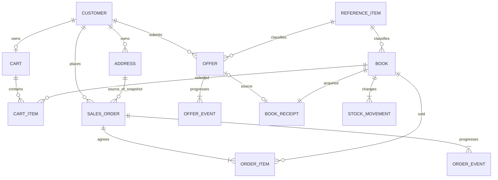

# 概念モデル

## 業務の単位と事実

販売の合意は注文全体、買取の申込は一件一冊、在庫の管理単位は書籍IDである。
同じ顧客が売り手・買い手・スタッフを兼ねても、顧客の同一性は一つの主体識別子で保つ。
ISBNや書名、金額の一致を取引・書籍の同一性に用いない。

| 分類 | 業務概念 | 記録すること・識別する単位 |
| --- | --- | --- |
| 資源 | 顧客 | 外部認証の主体識別子。氏名はログイン時の現在値 |
| 資源 | 配送先住所 | 顧客が持つ届け先。更新と有効→無効を扱う |
| 資源 | 書籍 | 書誌・分類・現在売価・公開状態。仕入単価が等しい在庫の単位 |
| 資源 | 参照データ項目 | 種別内で識別する分類選択肢。改名後も同じID |
| 作業中データ | かご・かご明細 | 購入意図と欲しい物。取引の成立ではなく在庫を予約しない |
| 成立事実 | 注文・注文明細 | 顧客が確定した一回の合意と、対象書籍・数量・単価・原価・配送先 |
| 進行事実 | 注文イベント | 確定・受付・出荷記録・配達記録・全体取消の各一回 |
| 申込事実 | 買取オファー | 顧客の書誌・分類・希望価格・申込時刻 |
| 進行事実 | 買取イベント | 申込・承認・受領記録・支払記録・却下・取下げ・棚入れ |
| 取得事実 | 書籍登録 | 手入力／棚入れの経路、仕入原価、初期数量、担当者 |
| 増減事実 | 在庫移動・棚卸調整 | 初期入庫・注文時減算・取消時返却・理由付きの増減。前後数量を保存 |
| 関係事実 | 注文明細・供給元オファー | 顧客と書籍の売買の成立回を注文IDで識別。棚入れ先書籍をオファーに一意対応 |
| 派生データ | 現在在庫・進行状態・棚入れ済 | 成立事実から再現できる現在値。条件検査用に保存 |
| 派生データ | 売上・粗利・買取支出・売れ筋 | 対象期間と取消除外規則を適用する照会時集計 |
| 技術記録 | コマンド実行結果 | 再送判定用の要求キー・内容ハッシュ・結果。業務イベントではない |

注文と買取は期間を持つ業務活動として識別し、各段階は独立した点イベントとして記録する。
期間自体の版管理はしない。注文が配達されるまで在庫引当履歴を毎段階作る設計ではなく、販売可能在庫は確定時に減る。
出荷・配達イベントの時刻はシステムへの記録操作の時刻であり、配送業者の実出荷日時や追跡履歴ではない。

## 概念の関係

図は上表と下記の多重度から導く。必須性は業務上のコミット時点を示す。

未ログインのかごには顧客がまだいない。書籍登録の供給元オファーは手入力時にはない。
書籍の4分類軸は参照データの種別を指定して結び、図では4本の参照を一つの概念関係にまとめている。
注文が参照する住所IDとは別に、配送先の値を注文へ保存する。住所IDだけで過去の届け先を説明しない。

## 所有責任と公開契約

すべて単一API・単一DB内の責任分担であり、別サービスや別DBを要求しない。

| 所有者 | 自ら更新するデータ | 他責任へ公開する契約 |
| --- | --- | --- |
| 顧客 | 顧客・住所 | 検証済み主体による氏名同期、本人の有効住所の照会・スナップショット取得 |
| 購入準備 | かご・明細 | 本人かごの確認、ログイン時統合、購入対象の消込み |
| 販売 | 注文・明細・注文イベント・注文状態 | 注文確定・全体取消・履行、本人注文照会、管理集計 |
| 買取 | オファー・買取イベント・買取状態 | 審査・受領・支払の記録、支払済オファーの棚入れ許可 |
| 在庫 | 書籍・書籍登録・在庫移動・現在在庫・参照データ | 現在値の照会、取得・数量減算・取消返却・棚卸調整 |

注文確定・取消・棚入れは複数所有者を調整する一つのローカルトランザクションにする。
所有者ごとの内部表を無制限に直接更新させず、[操作契約](transactions.md)を通す。
外部認証は本人確認と管理者判定、S3等は画像保管を担う。DBの外の副作用をDB取引に含めた保証はしない。

## パターンの適用

| パターン | このモデルでの適用・適用条件 | 根拠要件 |
| --- | --- | --- |
| P001 業務事実を分類する | 上表で資源・成立事実・進行事実・関係・派生値・技術記録を分ける | ENT-BOOK、ENT-ORDER、ENT-OFFER、ENT-STOCK-ADJUSTMENT |
| P002 点イベントと期間活動 | 注文・オファーの同一性を保ち、独立した段階を点イベントとして追記 | FR-ADM-04、FR-ADM-13、FR-ADM-14、05章§8 |
| P003 関係の成立回 | 注文IDと書籍IDの注文明細を関係事実として残す。別注文での再購入は別成立回。かご・分類の関係履歴は対象外 | ENT-ORDER-ITEM、RULE-TRADE-05 |
| P004 必要な属性の履歴 | 注文時の金額・住所のスナップショットと登録原価を保存。現在売価・氏名等はV2の通常更新。全属性の世代表は作らない | 07章§3、RULE-TRADE-04、RULE-TRADE-05、FR-CUS-09 |
| P005 業務取消 | 注文全体の取消事実と同量の在庫返却を原子的に追加。出荷後・部分取消は対象外 | RULE-STOCK-02、FR-CUS-11、05章§8.1 |
| P006 誤記録の訂正 | 通常資源属性の訂正と取引取消を区別。原価・注文・支払の訂正版や架空の返金は作らない。汎用訂正操作は対象外 | FR-ADM-08、RULE-OFFER-05、ADR-0001 |
| P007 時間軸 | 注文・申込・支払の業務時刻と記録時刻を区別。順序は連番で確定。二時制照会は対象外 | RULE-PERIOD-01、RULE-PERIOD-05、RULE-PERIOD-06 |
| P008 状態の導出 | 数量差分の合計、イベント連鎖の末端、凍結単価からの式を定義 | RULE-STOCK-01〜03、RULE-SALES-01〜04 |
| P009 原子的な遷移 | 在庫・対象活動の行をロックし、最新値で検査してから事実を確定 | NFR-SEC-08、RULE-STOCK-03、RULE-TRADE-02 |
| P010 コマンドの冪等化 | 再送可能な確定操作のキー・サーバ計算ハッシュ・結果を保存。取消一回・供給元一意は別の業務重複制約 | FR-CUS-07、FR-CUS-11、FR-ADM-14、FR-ADM-15 |
| P011 現在状態の保持 | 在庫・進行状態はV2の同一取引更新。ダッシュボード・かご金額はV1の照会時導出 | FR-ADM-01、FR-CUS-05、10章§5 |
| P012 所有者と公開契約 | 上表の責任と契約を用い、同一DB内で必要な即時整合性を保つ | CMP-API、CMP-DB、10章§5 |

パターン番号の全件採用を目的にしない。履歴の不要なかご・氏名・参照データ名をイベント化しない。
