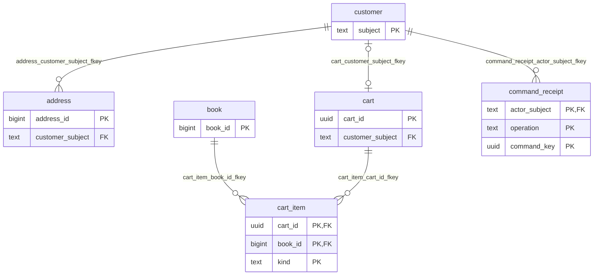
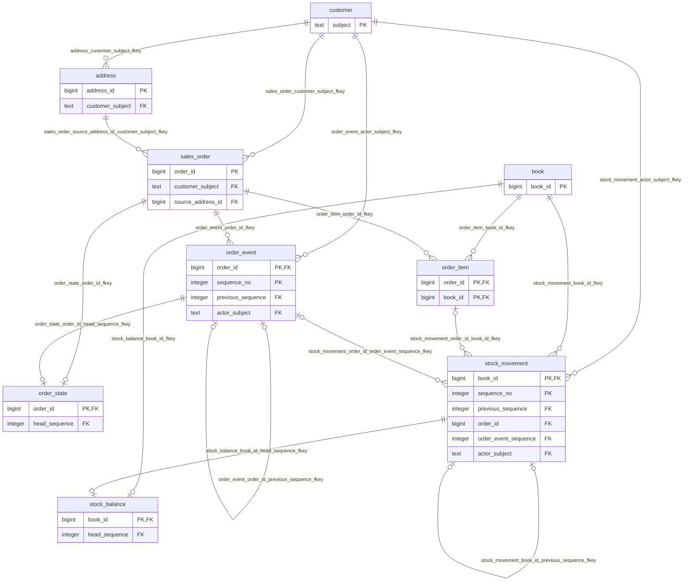
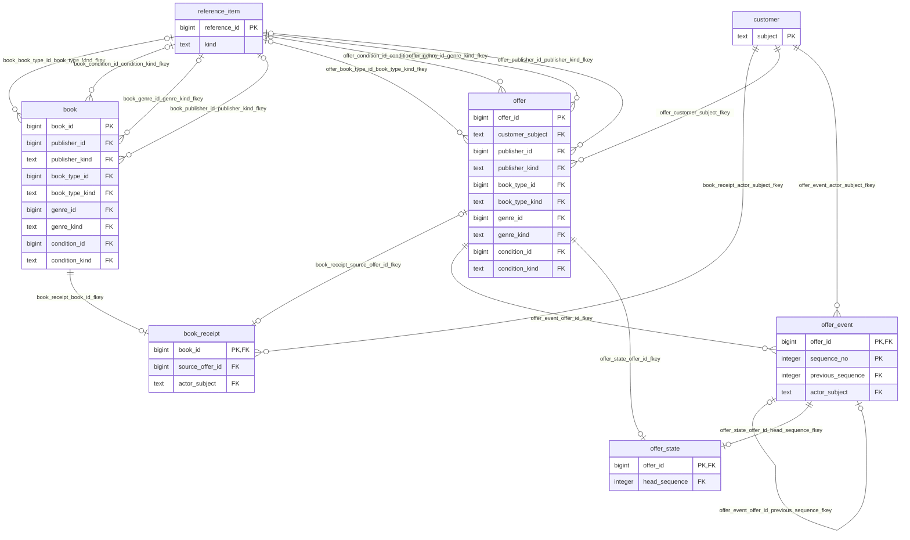

# 論理モデル

## 正本と現在状態

| データ | 正本・更新方針 | 現在値の求め方 |
| --- | --- | --- |
| 顧客・住所・参照データ・書籍の現在属性 | 通常更新。住所の削除は `active=false` | 行の現在値 |
| 書籍の原価と取得経路 | `book_receipt` に登録時の一件を保存、更新・削除しない | 当該書籍IDの登録事実 |
| 注文の合意 | `sales_order` と `order_item` の凍結値、更新・削除しない | 注文の確定値。取消後も合意内容は残る |
| 注文の進行 | `order_event` に連番を付けて追記 | 連鎖末端のイベントから `order_state` を導出 |
| 買取の申込と進行 | `offer` を凍結、`offer_event` を追記 | 連鎖末端から `offer_state` を導出。STOCKEDでも状態はPAID |
| 在庫 | `stock_movement` の前後数量と差分、取得事実との対応 | 書籍ごとの差分合計を `stock_balance` に保持 |
| かご | `cart`・`cart_item` は通常更新、購入と欲しい物を区別 | 現在売価による照会時集計 |
| 再送結果 | `command_receipt`、同一取引内で結果を確定 | 主体・操作・キーによる再取得 |

## キーと多重度

| 対象 | 識別と一意性 |
| --- | --- |
| 顧客 | 外部認証の `subject` がPK。氏名・メールをキーにしない |
| 書籍・住所・参照項目・オファー・注文 | `bigint identity`。注文には別の顧客向け一意な注文番号。欠番を許容 |
| 書籍登録 | 書籍IDがPK。供給元オファーIDは任意・一意。コミット時には各書籍に登録事実一件と初期在庫移動一件が必須 |
| かご | 暗号学的乱数のUUID。顧客主体にUNIQUE、NULLは複数可。顧客に最大一かご |
| かご明細 | (かごID,書籍ID,種別)。購入と欲しい物は併存可能 |
| 注文明細 | (注文ID,書籍ID)。同じ注文内の同じ書籍は数量をまとめる。注文には最低一行をAPI契約で保証 |
| 進行イベント | (活動ID,連番)。前イベントへの複合FKと連番＝前連番＋1。活動ID・イベント種別も一意 |
| 在庫移動 | (書籍ID,連番)。初回は登録または棚入れで前数量0。以後は前連番へのFKを持つ |
| 注文に伴う在庫移動 | 書籍ID・注文ID・移動種別で一意。元注文明細と元注文イベントへ複合FK |
| 冪等記録 | (主体,操作,コマンドキー)。業務事実のIDとは別 |

イベントの並びは時刻MAX・記録日時MAXに依存しない。線形連番の最大値が連鎖の末端を表す。
FKは参照先の存在、連番のCHECKは前後番号を守る。前状態から次状態への許可、前後在庫の連続性、数量と注文明細の一致は書込み契約で検査し、照合SQLでも検出する。

## 導出式と読取り

| 値 | 定義 |
| --- | --- |
| 販売可能在庫 | 初期登録／棚入れ数量 − 注文確定数量 ＋ 全体取消の返却数量 ＋ 棚卸差分 ＝ `sum(quantity_delta)` |
| 注文状態 | PLACED→PENDING、ACCEPTED→ORDERED、その他は末端イベント名。許可遷移は要件05章§8.1 |
| 買取状態 | SUBMITTED→PENDING_APPROVAL、STOCKED→PAID、それ以外は末端イベント名。棚入れ済は末端STOCKED |
| かご小計 | PURCHASE明細のみの `sum(現在売価×数量)`。WISHを含めない |
| 注文小計・税・合計 | `sum(凍結売価×数量)`、`round(小計×0.10,2)`、小計＋税 |
| 注文原価・粗利 | `sum(凍結原価×数量)`、税抜小計−原価。粗利は負になりうる |
| 売上・販売冊数 | 現在の状態が取消済以外の注文。期間はUTC注文日時で絞る |
| 買取支出 | PAID事実のあるオファーの申込価格を、PAIDの業務時刻で期間に割当てる |
| 原価既知売上 | 全明細で原価必須なので、対象注文の税抜売上と同額 |
| 納期超過 | UTC現在日付＞納品予定日、かつ配達済・取消済以外 |
| 在庫僅少 | 販売可能在庫≦5。0も含む。冊数指標の一覧件数は書籍行数、在庫総冊数は数量合計 |
| 売れ筋 | 取消済注文を除く累計販売数量の上位4書籍。同数は書籍ID順。非公開は除外 |

取消は元の小計や税をゼロに書き換えない。現在の状態を使う集計のため、後月の取消でも元の注文月の現在集計から除かれる。
過去時点で公表済みだった月次値の再現は要求されていない。
月の範囲はUTC月初0時から翌月初0時未満。任意の日付From/Toは、FromのUTC0時以上・To翌日のUTC0時未満へ変換する。
ダッシュボードは一つのSQL文で同じスナップショットを読む。別画面への遷移中に更新がなければ件数が一致する。画面をまたぐ時点固定の保証はしない。
画像URLは現在値のみ。プロフィール・書誌・参照データ名の過去値を注文時点へ戻す要件はなく、金額と配送先以外の表示名は現在値を参照する。

## 時間・保持・削除

時点は `timestamptz`。`occurred_at` は業務上の成立／操作時刻、`recorded_at` はDBに記録した時刻。
支払は実際の支払時刻を入力できる。月次支出に記録時刻を代用しない。出荷記録の時刻から実出荷日を推測しない。
システム時計のUTCを操作時刻として使い、任意の過去・未来への注文日変更を顧客に許可しない。検証データの固定時刻は試験専用である。
有効期間・システム認識期間の二時制照会は提供しない。

顧客・注文・オファーとその事実・凍結値・冪等記録は無期限保持。書籍と在庫の根拠も取引から参照されるため物理削除しない。
住所は無効化し、過去注文は凍結住所を読む。FKの削除連鎖はかご→かご明細だけに限る。
未ログインかごは最終更新から1年超で手動掃除できる（ISSUE-07の設計案）。顧客かごは掃除対象にしない。
画像の差替えはDB更新成功後に旧画像を削除する。アプリログの30日保持はDBの取引履歴と別である。

## 論理ER図

以下はDDLを適用したカタログから生成する。全PKとFK列を表示する。各関係のラベルはFK制約名。
図の最小多重度はDB制約によるもので、コミット時に必須となる登録事実・最低一注文明細・現在状態は上記のAPI契約を併せて読む。
自己参照の前連番は線形連鎖であり、同一活動の同じ前連番から二つの次連番は作れない。

<!-- generated-er:start -->

### 顧客・購入準備・技術記録

### 販売・在庫増減

### 買取・取得・分類

<!-- generated-er:end -->
