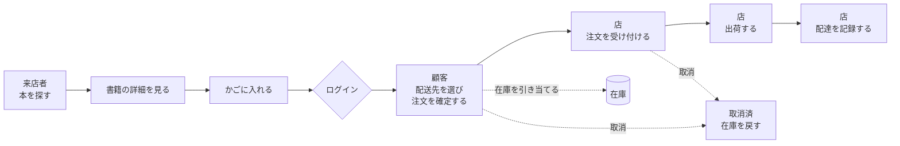
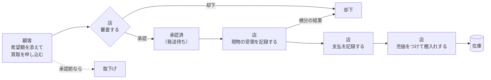

# 03 利用者と業務フロー

## 1. 利用者

| 利用者 | 誰か | 達したいこと | ログイン |
| --- | --- | --- | --- |
| **来店者** | ログインしていない訪問者 | 買う価値のある本があるかを確かめたい | 不要 |
| **顧客** | ログインした訪問者 | 本を買いたい。手持ちの本を売りたい | 必要 |
| **店舗スタッフ** | 管理者グループに属する利用者 | 在庫と取引を回し、事業が成り立っているかを知りたい | 必要（管理者権限） |
| **外部認証基盤** | 利用者の同一性を発行する仕組み | — | — |

**同一の利用者が顧客とスタッフを兼ねうる。** スタッフとしてログインしている間も、
店頭側の画面はそのまま使える。

**来店者はかごに入れるところまで進める。** 注文の確定でログインを求める。

### 1.1 顧客の同一性

顧客は **外部認証基盤が発行する主体識別子**で特定される。
氏名とメールアドレスは外部認証基盤が持ち、ログインのたびに本システムへ取り込まれる。
**本システムはパスワードを預からない**（[EXT-AUTH](08-external-interfaces.md)）。

かごは、未ログインの間は **かご識別子**（ブラウザに保持）で特定し、
ログインした時点で顧客に紐づけ替える（[D-01](decisions/README.md)）。

## 2. 販売の業務フロー

| 段階 | 誰が | 何をする | システムの外で起きること |
| --- | --- | --- | --- |
| 1 | 来店者 | 探す・かごに入れる | — |
| 2 | 顧客 | 配送先を選び注文を確定する | — |
| 3 | 店 | 注文を受け付ける | **代金の請求と受領**（電話・振込・店頭） |
| 4 | 店 | 出荷する | 梱包・発送手配 |
| 5 | 店 | 配達を記録する | — |

**在庫は注文の確定と同時に引き当てられる。** 以後の段階で在庫は動かない。
取消は受付済までしかできず、取消時に在庫が戻る（[RULE-STOCK-02](05-business-rules.md)）。

## 3. 買取の業務フロー

| 段階 | 誰が | 何をする | システムの外で起きること |
| --- | --- | --- | --- |
| 1 | 顧客 | 書誌・分類・**希望買取価格**を申告する | — |
| 2 | 店 | 承認または却下する | — |
| 3 | 顧客 | 現物を店へ送る | **配送**（送り先は画面が案内する — [D-06](decisions/README.md)） |
| 4 | 店 | 現物を検分し、受領を記録する | 検分。状態が申告と違えばここで却下できる |
| 5 | 店 | 支払を記録する | **送金**（振込・現金） |
| 6 | 店 | 売価をつけて棚入れする | — |

**店は買っていない本を売らない。** 棚入れは支払完了を要件とする（[RULE-TRADE-01](05-business-rules.md)）。

**買取価格は顧客が申告する。** 店にできるのは承認か却下だけで、金額の提示し直しはしない
（[ADR-0003](decisions/ADR-0003-defer-counter-offer.md)）。

## 4. 二つの流れの接点

**棚入れが唯一の接点である。**

| 引き継がれる | 引き継がれない |
| --- | --- |
| 書名・著者・ISBN・分類 4 軸 | 概要（棚入れ時に改めて与える） |
| **買取価格 → 仕入原価** | 表紙画像（棚入れ時に改めて用意する） |
| — | **売価**（店が独立に決める — [RULE-TRADE-03](05-business-rules.md)） |

棚入れによって生まれる書籍の在庫数は 1 冊である。

## 5. 現行業務との関係

| 業務 | 現行 | 稼働後 |
| --- | --- | --- |
| 店頭での買取・販売 | 対面・紙 | **変わらない。** システムの対象外 |
| オンラインの買取・販売 | なし | 本システム |
| 代金の授受 | 対面・現金 | **変わらない。** 本システムは記録しない |
| 在庫の把握 | 棚と記憶 | オンライン分のみ本システム。**店頭在庫とは二重管理になる**（[RISK-04](12-open-issues-and-risks.md)） |
