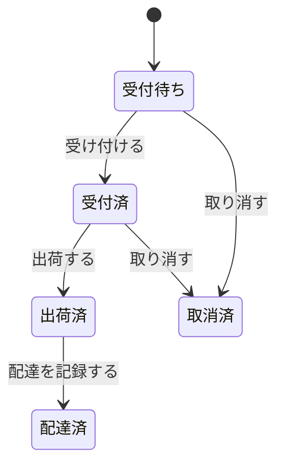
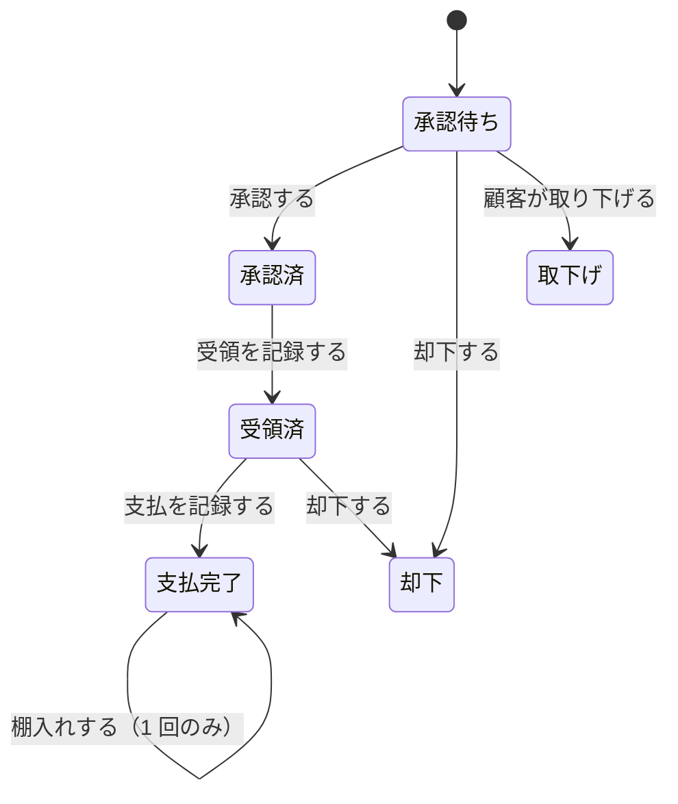
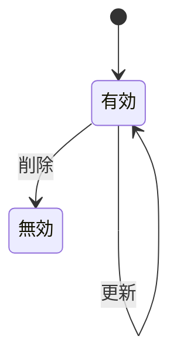

# 05 業務ルール

**店が決めた取り決め**の総覧。税率も納期もしきい値も、店が決めれば変わる。
基本設計以降でこれらの値を勝手に変えてはならない。

用語は [用語定義](../glossary.md) を正とする。

## 1. 金額

| ID | ルール |
| --- | --- |
| `RULE-MONEY-01` | 金額は通貨最小単位に丸める。負の金額は扱わない |
| `RULE-CART-01` | かご明細の小計 ＝ 書籍の**現在の**売価 × 数量 |
| `RULE-CART-02` | かごの合計は購入明細のみを対象とする。**欲しい物は含まない** |
| `RULE-ORDER-01` | 注文金額は 小計 → 税 → 合計 の順に導出する |
| `RULE-ORDER-02` | 注文明細の小計 ＝ **注文時に凍結した売価** × 数量 |
| `RULE-ORDER-03` | 税 ＝ 小計 × 税率。**税率は 10% の単一税率**（地域差を持たない） |
| `RULE-ORDER-04` | 合計 ＝ 小計 ＋ 税 |
| `RULE-ORDER-05` | **顧客に見せる額はすべて合計（税込）である**。送料・割引の概念を持たない |
| `RULE-ORDER-06` | 注文明細の粗利 ＝ (売価 − 仕入原価) × 数量 |

## 2. 在庫

| ID | ルール |
| --- | --- |
| `RULE-STOCK-01` | 注文確定時、注文された数量が書籍の在庫から引かれる |
| `RULE-STOCK-02` | 注文取消時、各明細の数量が書籍の在庫に戻される |
| `RULE-STOCK-03` | **在庫を超える出庫は拒否する。** 0 に飽和させない |
| `RULE-STOCK-04` | 在庫僅少 ＝ 在庫数 ≦ **5 冊**。**在庫 0 を含む**（補充を判断するための概念であるため） |
| `RULE-STOCK-05` | **在庫切れの書籍はかごに入れられない。** 検索結果には「在庫切れ」と明示して並べる |
| `RULE-STOCK-06` | かごに入れた後に在庫切れになった明細は、注文から除いてかごに残す。除いた書名を顧客に伝える |
| `RULE-STOCK-07` | 棚卸調整は在庫数を直接変更する。**調整前後の在庫数・差分・理由・実施者・実施日時を記録する** |
| `RULE-STOCK-08` | 非公開の書籍は店頭の検索結果・トップページに出ない。管理側の一覧には出る |

## 3. 取引の成立

| ID | ルール |
| --- | --- |
| `RULE-TRADE-01` | **店は買っていない本を売らない。** 棚入れは支払完了を要件とする |
| `RULE-TRADE-02` | 1 件の買取オファーは 1 冊の書籍になる。二重の棚入れは拒否する |
| `RULE-TRADE-03` | **売価は買取価格から導出しない。** 店の独立した決定である |
| `RULE-TRADE-04` | 仕入原価は書籍の登録時（棚入れまたは手入力）に確定し、以後変更できない |
| `RULE-TRADE-05` | 注文明細の売価・仕入原価は注文確定時に確定し、以後の値付け変更に追随しない |
| `RULE-TRADE-06` | 注文は最低 1 明細を要する |
| `RULE-TRADE-07` | **仕入原価は書籍の必須項目である。** 手入力の書籍にも入力を求める |

**`RULE-TRADE-07` の理由**: 仕入原価を持たない書籍が売れると粗利が算出できず、
[01 §4](01-background-and-goals.md) の効果測定が成立しない（[D-09](decisions/README.md)）。

## 4. 買取価格

| ID | ルール |
| --- | --- |
| `RULE-OFFER-01` | 買取価格は**顧客が申告する**。店は承認か却下だけを行う |
| `RULE-OFFER-02` | 希望買取価格の範囲は **1 以上 1,000,000 以下**。0 での申込は受け付けない |
| `RULE-OFFER-03` | 却下には理由の記録を要する。理由は顧客の申込一覧に表示される |
| `RULE-OFFER-04` | 顧客は**承認待ちの申込のみ**取り下げられる |
| `RULE-OFFER-05` | 買取価格は支払完了後に変更できない |

## 5. 期間と日付

| ID | ルール |
| --- | --- |
| `RULE-PERIOD-01` | すべての時点は UTC を基準とする |
| `RULE-PERIOD-02` | 「今月」は当月 1 日の 0 時 0 分 0 秒から始まる。問い合わせ時刻の時分秒は用いない |
| `RULE-PERIOD-03` | 納品予定日 ＝ **注文日 ＋ 7 日** |
| `RULE-PERIOD-04` | 納期超過 ＝ 納品予定日を過ぎ、かつ配達済でも取消済でもない |
| `RULE-PERIOD-05` | 買取の支出は**支払日**で期間に割り当てる。申込日ではない |
| `RULE-PERIOD-06` | 注文日 ＝ 顧客が注文を確定した日時。申込日 ＝ 顧客が買取を申し込んだ日時 |

**`RULE-PERIOD-02` の要点**: 15 日の 14 時に「今月」を問うたとき、期間の開始が
「1 日の 14 時」であってはならない。1 日の午前中の取引が漏れる。

## 6. 売上と粗利の計上

| ID | ルール |
| --- | --- |
| `RULE-SALES-01` | 取消済**以外**のすべての注文を売上に計上する |
| `RULE-SALES-02` | 売上は**税抜**である（税は他者のために預かるものであるため） |
| `RULE-SALES-03` | 粗利は 売上（税抜） − 仕入原価 で算出する |
| `RULE-SALES-04` | 買取支出は支払完了した買取価格の合計とする |

**`RULE-SALES-01` の根拠**: 注文は確定した時点で合意である。
出荷前でも受付前でも、それは成立した取引である。

**買取支出と売上は別の月に立つ。** 「今月の買取支出 − 今月の売上」は損益ではない。

## 7. 権限

| ID | ルール |
| --- | --- |
| `RULE-ACCESS-01` | 顧客向けの照会・操作は、必ず本人の主体識別子で絞り込む |
| `RULE-ACCESS-02` | 絞り込みなしの照会は管理者専用である |
| `RULE-ACCESS-03` | スタッフの権限は 1 種類とし、管理機能を細分化しない |

## 8. 状態遷移

### 8.1 注文

| 状態 | 売上計上 | 納期超過の対象 | 在庫 | 顧客が取り消せるか |
| --- | --- | --- | --- | --- |
| 受付待ち | ○ | ○ | 引当済 | ○ |
| 受付済 | ○ | ○ | 引当済 | ○ |
| 出荷済 | ○ | ○ | 店にない | ✗ |
| 配達済 | ○ | ✗ | 顧客の手元 | ✗ |
| 取消済 | ✗ | ✗ | 返却済 | ✗ |

**状態は前にしか進まない。** 出荷の取り消し、返品・返金は本システムの対象外とする
（[ISSUE-04](12-open-issues-and-risks.md)）。

### 8.2 買取オファー

| 状態 | 支払日 | 棚入れ | 顧客が取り下げられるか |
| --- | --- | --- | --- |
| 承認待ち | 未設定 | ✗ | ○ |
| 承認済（発送待ち） | 未設定 | ✗ | ✗ |
| 受領済 | 未設定 | ✗ | ✗ |
| 支払完了 | 設定済 | ○（未棚入れなら 1 回） | ✗ |
| 却下 | 未設定 | ✗ | ✗ |
| 取下げ | 未設定 | ✗ | ✗ |

**受領済からの却下を認める。** 現物が申告と違ったとき、店は検分の結果で断れなければならない。

### 8.3 配送先住所

**削除は選択肢から外すだけで、記録は残る。** その住所を使った過去の注文は、
削除後も配送先を参照できる。

## 9. 取り決めを持たない領域

以下について、**店として取り決めがない**。取り決めがないことも要件である。

| 領域 | 状態 |
| --- | --- |
| 売価の算定基準 | 基準なし。店の裁量（[ISSUE-05](12-open-issues-and-risks.md)） |
| 在庫僅少しきい値 5 の根拠 | 店主の経験則。運用しながら見直す |
| 納品予定日 7 日の根拠 | 店主の経験則。運用しながら見直す |
| 「売れ筋」の定義 | **累計の販売冊数の上位 4 件**とする（[D-12](decisions/README.md)） |
| 送料・割引・決済 | 概念を持たない（[ADR-0001](decisions/ADR-0001-defer-online-payment.md)） |
| 返品・返金 | 概念を持たない。店の既存運用で扱う |
