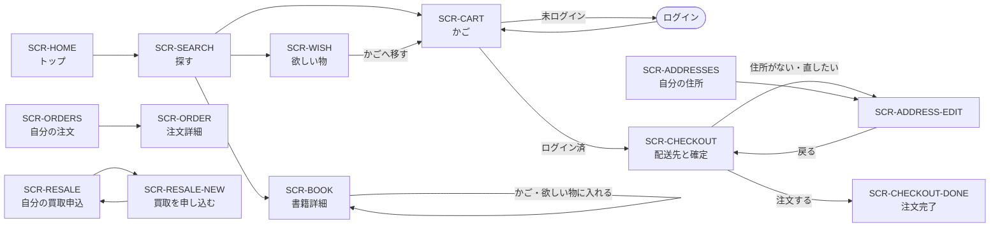
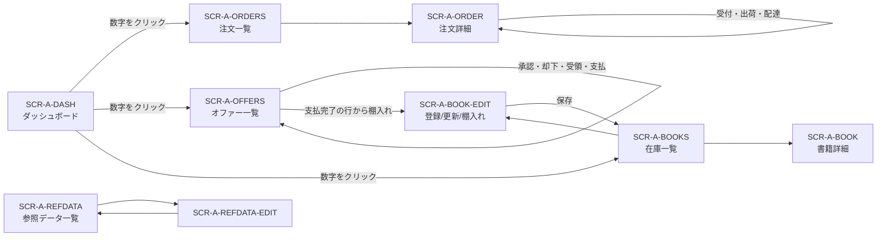

# 06 画面

**画面の増減は本章の一覧を正とする。** これが見積の主要な単位である。
各画面の版面確定・項目定義は基本設計で行う。

## 1. 画面一覧

### 1.1 店頭（顧客向け）

| 画面 | 名称 | ログイン | 主な機能 |
| --- | --- | --- | --- |
| `SCR-HOME` | トップ | 不要 | [FR-CUS-01](04-functional-requirements.md) |
| `SCR-SEARCH` | 書籍を探す | 不要 | [FR-CUS-02](04-functional-requirements.md) |
| `SCR-BOOK` | 書籍の詳細 | 不要 | [FR-CUS-03](04-functional-requirements.md), [FR-CUS-04](04-functional-requirements.md), [FR-CUS-06](04-functional-requirements.md) |
| `SCR-CART` | 買い物かご | 不要 | [FR-CUS-05](04-functional-requirements.md) |
| `SCR-WISH` | 欲しい物リスト | 不要 | [FR-CUS-06](04-functional-requirements.md) |
| `SCR-CHECKOUT` | 配送先の選択と注文確定 | 必要 | [FR-CUS-07](04-functional-requirements.md) |
| `SCR-CHECKOUT-DONE` | 注文完了 | 必要 | [FR-CUS-08](04-functional-requirements.md) |
| `SCR-ADDRESSES` | 自分の住所 | 必要 | [FR-CUS-09](04-functional-requirements.md) |
| `SCR-ADDRESS-EDIT` | 住所の登録／更新 | 必要 | [FR-CUS-09](04-functional-requirements.md) |
| `SCR-ORDERS` | 自分の注文 | 必要 | [FR-CUS-10](04-functional-requirements.md), [FR-CUS-11](04-functional-requirements.md) |
| `SCR-ORDER` | 注文の詳細 | 必要 | [FR-CUS-10](04-functional-requirements.md) |
| `SCR-RESALE` | 自分の買取申込 | 必要 | [FR-CUS-13](04-functional-requirements.md) |
| `SCR-RESALE-NEW` | 買取を申し込む | 必要 | [FR-CUS-12](04-functional-requirements.md) |
| `SCR-PRIVACY` | プライバシー | 不要 | — |
| `SCR-ERROR` | エラー | 不要 | [FR-CMN-03](04-functional-requirements.md) |

### 1.2 管理（スタッフ向け）

すべて**管理者グループに属していること**が条件。満たさない場合は到達できない。

| 画面 | 名称 | 主な機能 |
| --- | --- | --- |
| `SCR-A-DASH` | ダッシュボード | [FR-ADM-01](04-functional-requirements.md) |
| `SCR-A-ORDERS` | 注文一覧 | [FR-ADM-02](04-functional-requirements.md) |
| `SCR-A-ORDER` | 注文の詳細 | [FR-ADM-03](04-functional-requirements.md), [FR-ADM-04](04-functional-requirements.md) |
| `SCR-A-OFFERS` | 買取オファー一覧 | [FR-ADM-12](04-functional-requirements.md)〜[FR-ADM-14](04-functional-requirements.md) |
| `SCR-A-BOOKS` | 在庫一覧 | [FR-ADM-05](04-functional-requirements.md) |
| `SCR-A-BOOK` | 書籍の詳細 | [FR-ADM-06](04-functional-requirements.md) |
| `SCR-A-BOOK-EDIT` | 書籍の登録／更新／棚入れ | [FR-ADM-07](04-functional-requirements.md)〜[FR-ADM-10](04-functional-requirements.md), [FR-ADM-15](04-functional-requirements.md) |
| `SCR-A-REFDATA` | 参照データ一覧 | [FR-ADM-11](04-functional-requirements.md) |
| `SCR-A-REFDATA-EDIT` | 参照データの登録／改名 | [FR-ADM-11](04-functional-requirements.md) |
| `SCR-A-ERROR` | エラー（管理） | [FR-CMN-03](04-functional-requirements.md) |

**`SCR-A-BOOK-EDIT` は 1 画面 3 モードだが、版面は 2 つでよい。**
新規と更新は同じ項目で初期値の有無だけが違う。棚入れだけが編集できる項目を変える
（[04 §3.2](04-functional-requirements.md)）。

### 1.3 画面数

| 区分 | フェーズ 1 | フェーズ 2 | 計 |
| --- | --- | --- | --- |
| 店頭 | 13 | 2 | 15 |
| 管理 | 9 | 1 | 10 |
| **計** | **22** | **3** | **25** |

版面としては **26 版面**（`SCR-A-BOOK-EDIT` が 2 版面）である。

## 2. 画面遷移

### 2.1 店頭

**常時到達できる導線（ヘッダ）**: 探す／欲しい物／かごは常に。注文一覧と買取申込は**ログイン時のみ**。
自分の住所へは、ヘッダの利用者名から到達する。

### 2.2 管理

**ダッシュボードは「数える画面」であると同時に「仕事を配る画面」である。**
各数字が、その数字に一致する絞り込み済み一覧へ直接つながる。

## 3. 画面共通方針

全画面に共通する作法。個々の画面ではこれを繰り返さない。

| 事項 | 方針 |
| --- | --- |
| **結果の通知** | 操作が成功して別画面へ移ったときは、移動先の上部に通知バナーを 1 度だけ出す |
| **入力の不備** | 同じ画面に留まり、入力欄の直下に項目ごとのメッセージを出す。**入力内容は保つ** |
| **業務エラー** | 同じ画面に留まり、画面上部にメッセージを出す。**入力内容は保つ**（[D-03](decisions/README.md)） |
| **システムエラー** | 共通のエラー画面へ移る |
| **取り消せない操作** | 削除・取消は**確認ダイアログを挟む** |
| **一覧のページ送り** | 管理側の全一覧と店頭の検索結果に付す。1 ページ 20 件。**顧客側の自分の注文・住所・買取申込にも付す** |
| **一覧の並び順** | 既定は新しい順。検索結果のみ書名／価格を選べる |
| **空の一覧** | 「〜はありません」と伝え、**次に何をすればよいかを示す**（かごが空なら「本を探す」へ導く） |
| **金額の書式** | 全画面で同一の通貨書式。顧客向けは税込、管理向けは小計・税・合計の 3 段 |
| **日付の書式** | 日付のみを表示する（時刻は出さない） |
| **表紙画像がないとき** | 既定の表紙画像に差し替える |
| **状態を変える操作** | 送信操作（ボタン）で行う。二重送信・なりすまし送信を防ぐ |
| **ログインへの誘導** | ログインが要る画面に未ログインで来たら、ログイン後に元の画面へ戻す |

**業務エラーとシステムエラーの切り分け**（[D-03](decisions/README.md)）:

| 区分 | 例 | 見え方 |
| --- | --- | --- |
| **業務エラー** | 入力不備、在庫切れ、住所未登録、**他のスタッフが先に処理した**、**取り消せない状態の注文を取り消そうとした**、画像が不適正 | その場で伝え、やり直せる |
| **システムエラー** | 通信・保存の失敗、外部サービスへの到達不能 | 共通のエラー画面 |

**同時操作の競合を業務エラーに含めることが、この方針の要点である。**
複数のスタッフが同じ一覧を見ながら作業するため、日常的に起きる。

## 4. 主要画面のイメージ

版面の当たりを [画面イメージ](screen-images/README.md) に置く。
**要件定義で読み合わせるのは主要 10 画面**であり、残りはこれに準じるものとして基本設計で起こす。

| 画面イメージ | なぜこの画面を選ぶか |
| --- | --- |
| [`SCR-SEARCH`](screen-images/customer/SCR-SEARCH.html) | 顧客が最も多く使う |
| [`SCR-BOOK`](screen-images/customer/SCR-BOOK.html) | 買うかどうかを決める画面 |
| [`SCR-CART`](screen-images/customer/SCR-CART.html) | 数量・在庫・税込合計の見せ方が集まる |
| [`SCR-CHECKOUT`](screen-images/customer/SCR-CHECKOUT.html) | 注文が成立する画面 |
| [`SCR-ORDERS`](screen-images/customer/SCR-ORDERS.html) | 取消操作の出し分けを確かめる |
| [`SCR-RESALE-NEW`](screen-images/customer/SCR-RESALE-NEW.html) | 買取の入口。入力項目が業務そのもの |
| [`SCR-A-DASH`](screen-images/admin/SCR-A-DASH.html) | 経営指標の見せ方 |
| [`SCR-A-ORDER`](screen-images/admin/SCR-A-ORDER.html) | 注文履行の作業画面 |
| [`SCR-A-OFFERS`](screen-images/admin/SCR-A-OFFERS.html) | 買取の全段階が 1 画面で進む |
| [`SCR-A-BOOK-EDIT`](screen-images/admin/SCR-A-BOOK-EDIT.html) | 登録・更新・棚入れの 3 モード |

共通フレーム（ヘッダ・フッタ・通知バナーの位置）は
[店頭](screen-images/frame-customer.html)・[管理](screen-images/frame-admin.html) に置く。
