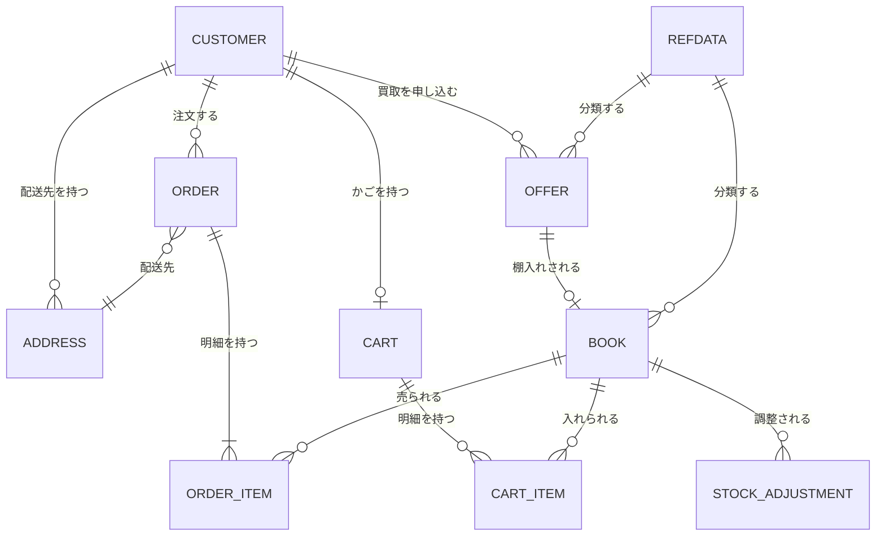

# 07 データ要件

**扱うデータの種類と主要項目**を定める。
列の型・桁数・索引・正規化の判断は基本設計で行う。

## 1. 概念データモデル

## 2. 主要エンティティ

| ID | エンティティ | 意味 | 主要項目 |
| --- | --- | --- | --- |
| `ENT-CUSTOMER` | 顧客 | 買う側にも売る側にもなりうる相手 | 主体識別子、姓、名、メールアドレス |
| `ENT-ADDRESS` | 配送先住所 | 顧客の届け先 | 顧客、住所行 1・2、市区町村、州、郵便番号、国、有効フラグ |
| `ENT-BOOK` | 書籍 | 販売可能な在庫 | 書名、著者、ISBN、分類 4 軸、売価、**仕入原価**、在庫数、概要、表紙画像 URL、**非公開フラグ**、供給元オファー |
| `ENT-OFFER` | 買取オファー | 顧客からの買取申込 | 顧客、書名、著者、ISBN、分類 4 軸、概要、**希望買取価格**、状態、**却下理由**、申込日、支払日、棚入れ済フラグ |
| `ENT-CART` | 買い物かご | 購入しようとしている書籍の集まり | かご識別子、顧客（ログイン後に紐づく）、最終更新日時 |
| `ENT-CART-ITEM` | かご明細 | かごの 1 行 | かご、書籍、数量、**種別（購入／欲しい物）** |
| `ENT-ORDER` | 注文 | 成立した売買の合意 | 注文番号、顧客、配送先、状態、注文日、納品予定日、小計、税、合計 |
| `ENT-ORDER-ITEM` | 注文明細 | 注文の 1 行 | 注文、書籍、数量、**凍結売価**、**凍結仕入原価** |
| `ENT-REFDATA` | 参照データ項目 | 分類の選択肢 | 種別（出版社／書籍種別／ジャンル／コンディション）、名称 |
| `ENT-STOCK-ADJUSTMENT` | 棚卸調整 | 注文以外の在庫増減の記録 | 書籍、調整前在庫数、調整後在庫数、理由、実施者、実施日時 |

**分類 4 軸はすべて `ENT-REFDATA` から供給される。**
出版社・書籍種別・ジャンル・コンディションは、種別が違うだけの同じ構造である。

## 3. データの凍結と参照

**成立した取引の金額は後から変わらない。** これは品質バーの一つである（[02 §5](02-scope.md)）。

| データ | 凍結する時点 | 凍結後 |
| --- | --- | --- |
| 注文明細の売価・仕入原価 | 注文確定時 | 書籍の値付けが変わっても追随しない |
| 書籍の仕入原価 | 書籍の登録時（棚入れ／手入力） | 変更できない |
| 買取価格 | 申込時 | 支払完了後は変更できない |
| 注文の配送先 | 注文確定時 | 住所が削除されても参照できる |

**配送先住所の削除は論理削除である。** 過去の注文が参照するためである。

## 4. データ量の見積

| エンティティ | 初期件数 | 年間増加 | 3 年後の見当 |
| --- | --- | --- | --- |
| 顧客 | 0 | 2,000 | 6,000 |
| 配送先住所 | 0 | 2,500 | 7,500 |
| 書籍 | 500（手入力で初期投入） | 6,000 | 18,500 |
| 買取オファー | 0 | 3,000 | 9,000 |
| 注文 | 0 | 4,000 | 12,000 |
| 注文明細 | 0 | 8,000 | 24,000 |
| 買い物かご／かご明細 | 0 | 10,000／25,000 | 30,000／75,000 |
| 参照データ項目 | 100 | 20 | 160 |
| 棚卸調整 | 0 | 500 | 1,500 |
| **表紙画像** | 500 枚 | 6,000 枚 | 18,500 枚（1 枚 200KB 想定＝約 3.7GB） |

**この規模では性能上の工夫を必要としない。**
テーブル総件数は 3 年後で 20 万件に満たず、単一のデータベースで足りる
（[NFR-PERF-01](09-non-functional-requirements.md)）。

**かごは放置されると際限なく増える。** 最終更新から 1 年を過ぎた未ログインのかごは
削除してよいものとする（削除の手段は基本設計で決める — [ISSUE-07](12-open-issues-and-risks.md)）。

## 5. 保持と削除

| データ | 保持期間 | 削除 |
| --- | --- | --- |
| 顧客・注文・買取オファー | 無期限 | 行わない（取引の記録であるため） |
| 配送先住所 | 無期限 | 論理削除のみ |
| 買い物かご（未ログイン） | 最終更新から 1 年 | 物理削除してよい |
| 表紙画像 | 書籍が存在する限り | 差し替え時に旧画像を削除する |
| アプリケーションログ | 30 日 | 自動失効 |

**個人情報として預かるのは氏名・メールアドレス・配送先住所のみである。**
メールアドレスは外部認証基盤が保持し、氏名はログインのたびに本システムへ取り込まれる。
保護の水準は [NFR-SEC-](09-non-functional-requirements.md) が定める。

## 6. 初期データ

| データ | 投入方法 | 責任 |
| --- | --- | --- |
| 参照データ項目（分類の選択肢） | 店が用意した一覧を投入する | 店＝一覧の提供、ベンダ＝投入 |
| 書籍（初期在庫 500 冊） | **稼働後に店が管理画面から手入力する** | 店 |
| 顧客 | 移行しない。ログイン時に生成される | — |

**既存データの一括移行は行わない**（[02 §3](02-scope.md)）。
現行の在庫は紙と表計算で管理されており、機械的に読み取れる形になっていないためである
（[ISSUE-01](12-open-issues-and-risks.md)）。
