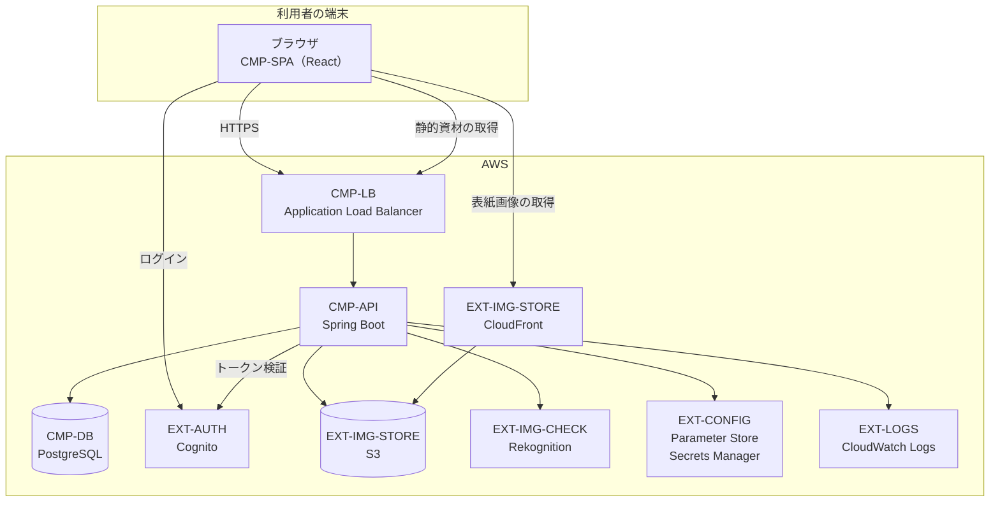

# 10 システム方式

**どう作るかの基本方針**を定める。
クラス構成・パッケージ構成・内部インタフェースは基本設計以降で定める。

本章は見積の前提である。**ここを変えると金額と納期が動く。**

## 1. 全体構成

## 2. 構成要素

| ID | 構成要素 | 役割 | 技術 |
| --- | --- | --- | --- |
| `CMP-SPA` | 画面 | 店頭・管理の全画面を単一のアプリケーションとして提供する | **React**（TypeScript、単一ページアプリケーション） |
| `CMP-API` | 業務ロジック | 業務ルールを守り、JSON を返す | **Spring Boot**（Java） |
| `CMP-DAO` | 永続化 | SQL とオブジェクトの対応づけ | **MyBatis** |
| `CMP-DB` | データ保管 | 業務データの保管 | **PostgreSQL** |
| `CMP-LB` | 受け口 | HTTPS の終端、静的資材と API の振り分け | Application Load Balancer |

**実行単位は `CMP-API` の 1 プロセスである。**
`CMP-SPA` の成果物（静的資材）は `CMP-API` と同じ実行単位から配信する。
分けないのは運用費と運用手数を抑えるためである（[11 §3](11-constraints-and-assumptions.md)）。

## 3. 画面と API の関係

**画面は JSON API を通じてのみサーバと通信する。** サーバは HTML を生成しない。

| 事項 | 方針 |
| --- | --- |
| API の様式 | REST 風。資源ごとに URL を持ち、JSON で入出力する |
| 画面遷移 | ブラウザ内で行う。**画面遷移のたびにサーバへ HTML を要求しない** |
| 業務エラーの伝達 | 専用の応答形式（エラー種別と、項目ごとのメッセージ）で返し、画面が表示する |
| 状態の保持 | 画面側は画面表示に必要な最小限のみ保持する。**業務上の状態はすべてサーバが持つ** |
| かごの保持 | **サーバのデータベースに保持する。** 未ログインの間はかご識別子をブラウザの Cookie に置く |

**かごをサーバに置くことが、[D-01](decisions/README.md)（ログイン後は端末をまたいでかごが引き継がれる）
を成立させる前提である。**

## 4. 認証・認可の方式

| 段階 | 方式 |
| --- | --- |
| ログイン | `CMP-SPA` が [EXT-AUTH](08-external-interfaces.md) のホスト画面へ送る（認可コードフロー ＋ PKCE） |
| トークンの保持 | ブラウザが保持する。**更新トークンは HttpOnly Cookie に置き、画面のスクリプトから読めないようにする** |
| API の認可 | `CMP-API` が要求ごとにトークンを検証する。**セッションを持たない** |
| 権限 | トークンに含まれる所属グループで、管理機能への到達を判定する（[NFR-SEC-03](09-non-functional-requirements.md)） |
| 顧客の登録 | トークン検証が初めて成功したとき、氏名を取り込んで顧客を登録・更新する |

## 5. 業務ロジックの置き場

**業務ルール（[05 業務ルール](05-business-rules.md)）は `CMP-API` にのみ置く。**

| 置いてよいもの | 置いてはいけないもの |
| --- | --- |
| `CMP-SPA`: 入力欄の形式検査（必須・数値・桁）、表示の整形 | `CMP-SPA`: 金額の計算、状態遷移の可否判定、しきい値の判断 |
| `CMP-API`: 業務ルールのすべて、金額計算、状態遷移、権限判定 | `CMP-API`: 画面の版面に関する判断 |
| `CMP-DB`: 参照整合性、一意制約、非負制約 | `CMP-DB`: 業務ルール（ストアドプロシージャを用いない） |

**画面側の検査は利便のためであり、根拠ではない。** 同じ検査を必ずサーバ側でも行う。

**注文の確定は、注文の作成・在庫の引き当て・かごの消し込みを一つのトランザクションで行う。**
在庫の引き当てには行ロックを用い、二重販売を防ぐ（[NFR-SEC-08](09-non-functional-requirements.md)）。

## 6. 規模の見当

| 指標 | 数 | 根拠 |
| --- | --- | --- |
| 画面（版面） | 26 | [06 §1.3](06-screens.md) |
| API エンドポイント | 約 45 | 照会 22／更新 23。画面と機能の対応から算出 |
| テーブル | 12 | [07 §2](07-data-requirements.md) の 10 エンティティ ＋ 中間表・採番表 |
| バッチ | 0 | 定時処理を持たない（かごの掃除は基本設計で方式を決める — [ISSUE-07](12-open-issues-and-risks.md)） |
| 帳票 | 0 | 印刷物を持たない |
| 外部インタフェース | 5 | [08 §1](08-external-interfaces.md) |

工数への換算は [規模・体制・スケジュール](../estimate/scope-and-schedule.md) にある。

## 7. 環境

| 環境 | 用途 | 構成 |
| --- | --- | --- |
| 開発 | 開発者の手元 | 全外部連携をローカル実装に差し替える（[08 §4](08-external-interfaces.md)）。データベースはコンテナ |
| 試験 | 結合・総合テスト | 本番と同じ構成の最小版。外部連携は本物を用いる |
| 本番 | 稼働 | 下表 |

**本番構成**

| 要素 | 構成 | 冗長化 |
| --- | --- | --- |
| `CMP-API`（`CMP-SPA` を同梱） | 単一の実行単位 | **なし。** 異常終了時の自動再起動のみ |
| `CMP-DB` | 単一構成のマネージドデータベース | **なし。** 1 日 1 回のバックアップ（[NFR-AVAIL-03](09-non-functional-requirements.md)） |
| `CMP-LB` | マネージドロードバランサ | 標準の冗長構成 |

**冗長化しないことは合意済みの割り切りである**（[RISK-03](12-open-issues-and-risks.md)）。

## 8. 開発方式

| 事項 | 方針 |
| --- | --- |
| 版管理 | Git。基本設計完了後に実装を開始する |
| 構成管理 | ビルドと配置を自動化する。手作業での本番配置を行わない |
| 単体テスト | 業務ルールを持つ層に対して自動テストを書く。**[05 業務ルール](05-business-rules.md) の各 `RULE-` に対応する試験を持つことを完了条件とする** |
| 結合テスト | 画面と API を通した業務シナリオで確認する |
| コード生成の利用 | 認めるが、**[必達] の非機能要件と業務ルールの検証は人が行う** |
